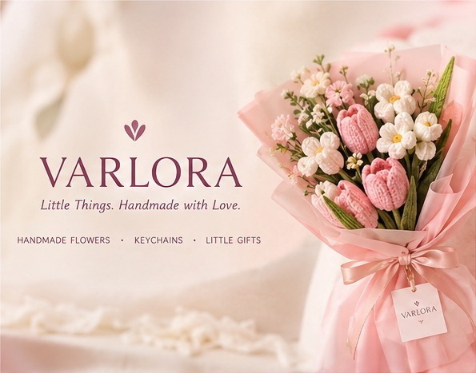
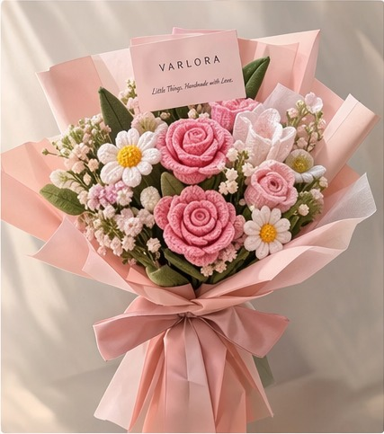
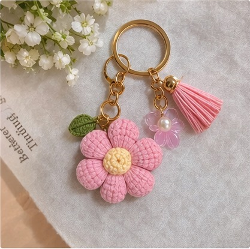
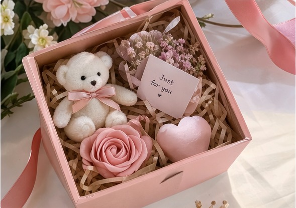
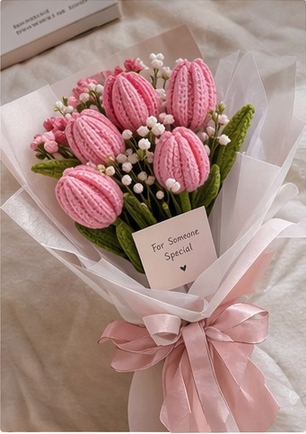
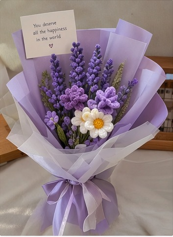
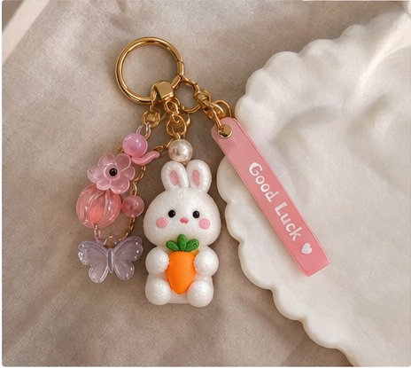
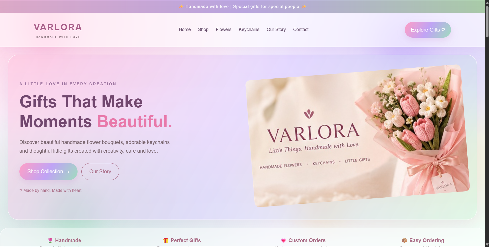

# Ex02 Commercial Website
## Date: 31/10/2026

## AIM
To create a commercial website using CSS Flexbox.

## ALGORITHM
### STEP 1
Create an HTML file (index.html)

### STEP 2
Create a CSS file (style.css)

### STEP 3
Include a navigation bar with links to different sections.

### STEP 4
Add structured sections for Homepage, Products / Services, About Us, Contact Details and User Account.

### STEP 5
Include social media links at the footer with copyright information.

### STEP 6
Define global styles for fonts, colors, and layout.

### STEP 7
Style the header, navigation bar, and sections.

### STEP 8
Use Flexbox for layout design.

### STEP 9
Add hover effects and transitions for interactivity.

### STEP 10
Add Images and Media.

### STEP 11
Use optimized images for a professional look.

### STEP 12
Open the HTML file in a browser to check layout and functionality.

### STEP 13
Fix styling issues and refine content placement.

### STEP 14
Deploy the website.

### STEP 15
Upload to GitHub Pages for free hosting.

## PROGRAM
### HTML
```

<!DOCTYPE html>
<html lang="en">

<head>
    <meta charset="UTF-8">
    <meta name="viewport" content="width=device-width, initial-scale=1.0">

    <title>VARLORA | Handmade Gifts & Flowers</title>

    <link rel="stylesheet" href="style.css">
</head>

<body>

    <!-- ANNOUNCEMENT BAR -->

    <div class="announcement">
        ✨ Handmade with love | Special gifts for special people ✨
    </div>

    <!-- HEADER -->

    <header>

        <a href="#home" class="logo">
            VARLORA
            <span>HANDMADE WITH LOVE</span>
        </a>

        <nav>
            <a href="#home">Home</a>
            <a href="#shop">Shop</a>
            <a href="#flowers">Flowers</a>
            <a href="#keychains">Keychains</a>
            <a href="#about">Our Story</a>
            <a href="#contact">Contact</a>
        </nav>

        <a href="#shop" class="header-btn">Explore Gifts ♡</a>

    </header>

    <!-- HERO SECTION -->

    <section id="home" class="hero">

        <div class="hero-content">

            <p class="subtitle">A LITTLE LOVE IN EVERY CREATION</p>

            <h1>
                Gifts That Make<br>
                Moments <span>Beautiful.</span>
            </h1>

            <p class="hero-description">
                Discover beautiful handmade flower bouquets,
                adorable keychains and thoughtful little gifts
                created with creativity, care and love.
            </p>

            <div class="hero-buttons">
                <a href="#shop" class="primary-btn">
                    Shop Collection →
                </a>

                <a href="#about" class="secondary-btn">
                    Our Story
                </a>
            </div>

            <p class="hero-note">
                ♡ Made by hand. Made with heart.
            </p>

        </div>

        <div class="hero-image">
            
        </div>

    </section>

    <!-- BENEFITS -->

    <section class="benefits">

        <div>
            <h3>🌷 Handmade</h3>
            <p>Created with love and care</p>
        </div>

        <div>
            <h3>🎁 Perfect Gifts</h3>
            <p>For every special occasion</p>
        </div>

        <div>
            <h3>💗 Custom Orders</h3>
            <p>Made according to your choice</p>
        </div>

        <div>
            <h3>📦 Easy Ordering</h3>
            <p>Order through WhatsApp</p>
        </div>

    </section>

    <!-- SHOP COLLECTION -->

    <section id="shop" class="shop section">

        <p class="subtitle">MADE JUST FOR YOU</p>

        <h2>Explore Our Collections</h2>

        <p class="section-text">
            Little creations that bring big smiles.
        </p>

        <div class="collection-grid">

            <a href="#flowers" class="collection-card">
                
                <div>
                    <h3>Floral Bouquets</h3>
                    <p>Beautiful flowers that last forever →</p>
                </div>
            </a>

            <a href="#keychains" class="collection-card">
                
                <div>
                    <h3>Cute Keychains</h3>
                    <p>Little accessories, big happiness →</p>
                </div>
            </a>

            <a href="#gifts" class="collection-card">
                
                <div>
                    <h3>Little Gifts</h3>
                    <p>Thoughtful gifts for your loved ones →</p>
                </div>
            </a>

        </div>

    </section>

    <!-- FLOWERS -->

    <section id="flowers" class="products section">

        <p class="subtitle">FOREVER IN BLOOM</p>

        <h2>Handmade Floral Collection</h2>

        <p class="section-text">
            Flowers crafted to make every moment memorable.
        </p>

        <div class="product-grid">

            <div class="product-card">

                

                <div class="product-info">

                    <span class="product-tag">BEST SELLER</span>

                    <h3>Pink Floral Bouquet</h3>

                    <p>Beautiful handmade pink flower arrangement.</p>

                    <h3 class="price">₹499</h3>

                    <a href="https://wa.me/91YOURNUMBER?text=Hi%20VARLORA%2C%20I%20want%20to%20order%20Pink%20Floral%20Bouquet"
                       class="order-btn">
                        Order Now ♡
                    </a>

                </div>

            </div>

            <div class="product-card">

                

                <div class="product-info">

                    <span class="product-tag">HANDMADE</span>

                    <h3>Lavender Dreams</h3>

                    <p>A lovely lavender-themed floral bouquet.</p>

                    <h3 class="price">₹599</h3>

                    <a href="https://wa.me/91YOURNUMBER?text=Hi%20VARLORA%2C%20I%20want%20to%20order%20Lavender%20Dreams"
                       class="order-btn">
                        Order Now ♡
                    </a>

                </div>

            </div>

            <div class="product-card">

                

                <div class="product-info">

                    <span class="product-tag">POPULAR</span>

                    <h3>Forever Bloom</h3>

                    <p>A colorful handmade floral creation.</p>

                    <h3 class="price">₹699</h3>

                    <a href="https://wa.me/91YOURNUMBER?text=Hi%20VARLORA%2C%20I%20want%20to%20order%20Forever%20Bloom"
                       class="order-btn">
                        Order Now ♡
                    </a>

                </div>

            </div>

        </div>

    </section>

    <!-- KEYCHAINS -->

    <section id="keychains" class="products section">

        <p class="subtitle">SMALL THINGS, BIG SMILES</p>

        <h2>Handmade Keychains</h2>

        <p class="section-text">
            Cute little creations to carry everywhere.
        </p>

        <div class="product-grid">

            <div class="product-card">

                

                <div class="product-info">

                    <h3>Floral Charm Keychain</h3>

                    <p>A cute handmade floral accessory.</p>

                    <h3 class="price">₹149</h3>

                    <a href="https://wa.me/91YOURNUMBER?text=Hi%20VARLORA%2C%20I%20want%20Floral%20Charm%20Keychain"
                       class="order-btn">
                        Order Now ♡
                    </a>

                </div>

            </div>

            <div class="product-card">

                

                <div class="product-info">

                    <h3>Mini Cute Keychain</h3>

                    <p>A lovely little gift for everyday use.</p>

                    <h3 class="price">₹199</h3>

                    <a href="https://wa.me/91YOURNUMBER?text=Hi%20VARLORA%2C%20I%20want%20Mini%20Cute%20Keychain"
                       class="order-btn">
                        Order Now ♡
                    </a>

                </div>

            </div>

        </div>

    </section>

    <!-- LITTLE GIFTS -->

    <section id="gifts" class="products section">

        <p class="subtitle">GIFT SOME HAPPINESS</p>

        <h2>Little Gifts & Surprises</h2>

        <p class="section-text">
            Make birthdays, anniversaries and special days unforgettable.
        </p>

        <div class="product-grid">

            <div class="product-card">

                

                <div class="product-info">

                    <h3>Mini Surprise Box</h3>

                    <p>A cute little gift box filled with love.</p>

                    <h3 class="price">₹299</h3>

                    <a href="https://wa.me/91YOURNUMBER?text=Hi%20VARLORA%2C%20I%20want%20Mini%20Surprise%20Box"
                       class="order-btn">
                        Order Now ♡
                    </a>

                </div>

            </div>

        </div>

    </section>

    <!-- CUSTOM ORDER BANNER -->

    <section class="custom-order">

        <div>
            <p class="subtitle">YOUR IDEA, OUR CREATION</p>

            <h2>Something Special in Mind?</h2>

            <p>
                Want a customized bouquet, personalized keychain
                or a special gift box? Tell us your idea.
                We'll help make it special!
            </p>

            <a href="https://wa.me/91YOURNUMBER?text=Hi%20VARLORA%2C%20I%20want%20a%20custom%20gift"
               class="primary-btn">
                Create Your Custom Gift →
            </a>
        </div>

    </section>

    <!-- ABOUT -->

    <section id="about" class="about section">

        <div class="about-image">
            
        </div>

        <div class="about-content">

            <p class="subtitle">THE STORY BEHIND VARLORA</p>

            <h2>Made with Love, Created for Smiles.</h2>

            <p>
                VARLORA is a handmade gifting brand built around
                creativity, happiness and thoughtful little moments.
            </p>

            <p>
                From beautiful floral bouquets to adorable
                keychains and unique gifts, every creation is
                designed to make someone feel special.
            </p>

            <p>
                We believe the most meaningful gifts are not
                always expensive. They are the ones made with love.
            </p>

            <h3>♡ Every creation tells a story.</h3>

        </div>

    </section>

    <!-- CONTACT -->

    <section id="contact" class="contact section">

        <p class="subtitle">WE WOULD LOVE TO HEAR FROM YOU</p>

        <h2>Let's Connect!</h2>

        <p>
            Have a question or want to place a custom order?
            Get in touch with us.
        </p>

        <div class="contact-details">

            <p>📧 Email: hello@varlora.com</p>

            <p>📍 Location: Tamil Nadu, India</p>

            <p>📱 WhatsApp: Contact us for orders</p>

            <p>
                Instagram:
                <a href="https://www.instagram.com/">
                    Follow VARLORA
                </a>
            </p>

        </div>

        <form action="mailto:hello@varlora.com"
              method="post"
              enctype="text/plain">

            <input type="text"
                   name="name"
                   placeholder="Your Name"
                   required>

            <input type="email"
                   name="email"
                   placeholder="Your Email"
                   required>

            <textarea name="message"
                      placeholder="Your Message"
                      required></textarea>

            <button type="submit">Send Message ♡</button>

        </form>

    </section>

    <!-- FOOTER -->

    <footer>

        <h2>VARLORA</h2>

        <p>Little Things. Handmade with Love.</p>

        <div class="footer-links">
            <a href="#home">Home</a>
            <a href="#shop">Shop</a>
            <a href="#about">About Us</a>
            <a href="#contact">Contact</a>
        </div>

        <div class="social-links">

            <a href="https://www.instagram.com/">
                Instagram
            </a>

            <a href="https://www.facebook.com/">
                Facebook
            </a>

            <a href="https://www.pinterest.com/">
                Pinterest
            </a>

        </div>

        <hr>

        <p>
            © 2026 VARLORA. All Rights Reserved.
        </p>

        <p>Made with ♡ for beautiful moments.</p>

        <a href="#home">Back to Top ↑</a>

    </footer>

</body>
</html>
```

### CSS 
```

/* GLOBAL SETTINGS */

* {
    margin: 0;
    padding: 0;
    box-sizing: border-box;
    scroll-behavior: smooth;
}

body {
    font-family: Arial, sans-serif;
    background: #fffaf8;
    color: #44343a;
    line-height: 1.7;
}

a {
    text-decoration: none;
}

/* ANNOUNCEMENT */

.announcement {
    background: #a96d86;
    color: white;
    text-align: center;
    padding: 9px;
    font-size: 13px;
    letter-spacing: 1px;
}

/* HEADER */

header {
    display: flex;
    justify-content: space-between;
    align-items: center;
    padding: 22px 7%;
    background: white;
    position: sticky;
    top: 0;
    z-index: 100;
    box-shadow: 0 2px 12px #00000008;
}

.logo {
    font-size: 27px;
    font-weight: bold;
    color: #a96d86;
    letter-spacing: 3px;
}

.logo span {
    display: block;
    font-size: 9px;
    letter-spacing: 2px;
    color: #88727b;
    text-align: center;
}

nav {
    display: flex;
    gap: 23px;
}

nav a {
    color: #55444b;
    font-size: 14px;
    transition: 0.3s;
}

nav a:hover {
    color: #bd7897;
}

.header-btn {
    background: #a96d86;
    color: white;
    padding: 11px 19px;
    border-radius: 25px;
    transition: 0.3s;
}

.header-btn:hover {
    background: #80516a;
}

/* HERO */

.hero {
    display: flex;
    align-items: center;
    justify-content: space-between;
    gap: 45px;
    padding: 75px 8%;
    background: #f8e9ed;
}

.hero-content {
    flex: 1;
}

.subtitle {
    color: #ae718b;
    font-size: 12px;
    font-weight: bold;
    letter-spacing: 3px;
    margin-bottom: 15px;
}

.hero h1 {
    font-size: 52px;
    line-height: 1.2;
    color: #49323e;
    margin-bottom: 20px;
}

.hero h1 span {
    color: #b36d8c;
}

.hero-description {
    max-width: 480px;
    color: #75616a;
    margin-bottom: 25px;
}

.hero-buttons {
    display: flex;
    flex-wrap: wrap;
    gap: 12px;
}

.primary-btn {
    display: inline-block;
    background: #a96d86;
    color: white;
    padding: 13px 25px;
    border-radius: 5px;
    transition: 0.3s;
}

.primary-btn:hover {
    background: #80516a;
    transform: translateY(-3px);
}

.secondary-btn {
    display: inline-block;
    border: 1px solid #a96d86;
    color: #a96d86;
    padding: 12px 24px;
    border-radius: 5px;
}

.secondary-btn:hover {
    background: white;
}

.hero-note {
    margin-top: 22px;
    font-size: 13px;
    color: #a96d86;
}

.hero-image {
    flex: 1;
}

.hero-image img {
    width: 100%;
    height: 400px;
    object-fit: cover;
    border-radius: 15px;
}

/* BENEFITS */

.benefits {
    display: flex;
    justify-content: space-around;
    flex-wrap: wrap;
    gap: 20px;
    padding: 30px 6%;
    background: white;
    text-align: center;
}

.benefits h3 {
    color: #a96d86;
    font-size: 16px;
}

.benefits p {
    font-size: 13px;
    color: #887b80;
}

/* COMMON SECTION */

.section {
    padding: 75px 8%;
}

.section h2 {
    font-size: 34px;
    color: #49323e;
    text-align: center;
    margin-bottom: 12px;
}

.section-text {
    text-align: center;
    color: #89777e;
    margin-bottom: 35px;
}

/* SHOP COLLECTION */

.shop {
    text-align: center;
}

.collection-grid {
    display: flex;
    justify-content: center;
    gap: 25px;
    margin-top: 35px;
    flex-wrap: wrap;
}

.collection-card {
    flex: 1;
    min-width: 230px;
    max-width: 350px;
    background: white;
    border-radius: 12px;
    overflow: hidden;
    box-shadow: 0 5px 20px #0000000b;
    transition: 0.3s;
}

.collection-card:hover {
    transform: translateY(-8px);
}

.collection-card img {
    width: 100%;
    height: 250px;
    object-fit: cover;
}

.collection-card div {
    padding: 20px;
}

.collection-card h3 {
    color: #a96d86;
    font-size: 20px;
}

.collection-card p {
    color: #83727a;
    font-size: 13px;
}

/* PRODUCTS */

.products {
    background: #fdf2f3;
    text-align: center;
}

.product-grid {
    display: flex;
    justify-content: center;
    flex-wrap: wrap;
    gap: 25px;
    margin-top: 35px;
}

.product-card {
    flex: 1;
    min-width: 230px;
    max-width: 320px;
    background: white;
    border-radius: 12px;
    overflow: hidden;
    text-align: left;
    box-shadow: 0 5px 20px #0000000b;
    transition: 0.3s;
}

.product-card:hover {
    transform: translateY(-7px);
    box-shadow: 0 10px 25px #a96d8620;
}

.product-card img {
    width: 100%;
    height: 250px;
    object-fit: cover;
    transition: 0.4s;
}

.product-card:hover img {
    transform: scale(1.04);
}

.product-info {
    padding: 20px;
}

.product-tag {
    color: #a96d86;
    font-size: 10px;
    font-weight: bold;
    letter-spacing: 2px;
}

.product-info h3 {
    margin: 9px 0;
    color: #49323e;
}

.product-info p {
    font-size: 13px;
    color: #88777e;
    margin-bottom: 12px;
}

.price {
    color: #a96d86 !important;
    font-size: 21px;
}

.order-btn {
    display: block;
    text-align: center;
    padding: 11px;
    background: #a96d86;
    color: white;
    border-radius: 5px;
    margin-top: 15px;
    transition: 0.3s;
}

.order-btn:hover {
    background: #80516a;
}

/* CUSTOM ORDER */

.custom-order {
    padding: 75px 10%;
    background: #ead5df;
    text-align: center;
}

.custom-order h2 {
    font-size: 35px;
    color: #49323e;
    margin-bottom: 15px;
}

.custom-order p {
    max-width: 650px;
    margin: 0 auto 25px;
}

/* ABOUT */

.about {
    display: flex;
    align-items: center;
    gap: 50px;
}

.about-image {
    flex: 1;
}

.about-image img {
    width: 100%;
    height: 370px;
    object-fit: cover;
    border-radius: 12px;
}

.about-content {
    flex: 1;
}

.about-content h2 {
    text-align: left;
}

.about-content p {
    margin: 15px 0;
    color: #75636b;
}

.about-content h3 {
    color: #a96d86;
    margin-top: 20px;
}

/* CONTACT */

.contact {
    background: #fdf2f3;
    text-align: center;
}

.contact-details {
    margin: 25px 0;
}

.contact-details p {
    margin: 10px;
}

.contact-details a {
    color: #a96d86;
}

form {
    display: flex;
    flex-direction: column;
    gap: 15px;
    max-width: 500px;
    margin: 30px auto;
}

input, textarea {
    padding: 14px;
    border: 1px solid #e3cbd5;
    background: white;
    border-radius: 6px;
    outline: none;
    font-size: 14px;
}

input:focus, textarea:focus {
    border-color: #a96d86;
}

textarea {
    height: 120px;
    resize: vertical;
}

button {
    padding: 14px;
    background: #a96d86;
    border: none;
    border-radius: 6px;
    color: white;
    font-size: 15px;
    cursor: pointer;
    transition: 0.3s;
}

button:hover {
    background: #80516a;
}

/* FOOTER */

footer {
    background: #49323e;
    color: white;
    text-align: center;
    padding: 40px 20px;
}

footer h2 {
    color: #e9b6c9;
    letter-spacing: 4px;
}

footer p {
    margin: 12px;
    font-size: 13px;
}

.footer-links, .social-links {
    display: flex;
    justify-content: center;
    flex-wrap: wrap;
    gap: 25px;
    margin: 22px;
}

footer a {
    color: #f2d4df;
    transition: 0.3s;
}

footer a:hover {
    color: white;
}

footer hr {
    border: none;
    border-top: 1px solid #755d69;
    margin: 20px 0;
}

/* RESPONSIVE DESIGN */

@media (max-width: 900px) {

    header {
        flex-direction: column;
        gap: 18px;
    }

    nav {
        justify-content: center;
        flex-wrap: wrap;
    }

    .hero {
        flex-direction: column;
        text-align: center;
    }

    .hero-description {
        margin-left: auto;
        margin-right: auto;
    }

    .hero-buttons {
        justify-content: center;
    }

    .about {
        flex-direction: column;
    }

    .about-content h2 {
        text-align: center;
    }
}

@media (max-width: 600px) {

    .hero h1 {
        font-size: 37px;
    }

    .section {
        padding: 50px 6%;
    }

    .section h2 {
        font-size: 27px;
    }

    nav {
        gap: 12px;
    }

    nav a {
        font-size: 12px;
    }

    .hero-image img {
        height: 270px;
    }

    .benefits {
        flex-direction: column;
    }

    .collection-card,
    .product-card {
        max-width: 100%;
    }
}


/* ==================================
   VARLORA - GLASS FLOWER GARDEN THEME
================================== */

:root {
    --pink: #f4b9d0;
    --purple: #c9b5ed;
    --green: #a8c9a5;
    --dark: #49364b;
    --glass: rgba(255, 255, 255, 0.38);
}

html {
    scroll-behavior: smooth;
}

body {
    background:
        radial-gradient(circle at 10% 10%, #fce0ed, transparent 35%),
        radial-gradient(circle at 90% 30%, #e6ddfa, transparent 35%),
        radial-gradient(circle at 40% 85%, #e0f0df, transparent 35%),
        linear-gradient(135deg, #fff8fb, #f5efff, #f3faf0);
    background-attachment: fixed;
    color: var(--dark);
}

/* Announcement */
.announcement {
    background: linear-gradient(90deg, #dca9c7, #b9a5df, #a9cba8);
    color: white;
    letter-spacing: 1px;
}

/* Glass Header */
header {
    background: rgba(255, 255, 255, 0.42);
    backdrop-filter: blur(22px);
    -webkit-backdrop-filter: blur(22px);
    border-bottom: 1px solid rgba(255,255,255,0.65);
    box-shadow: 0 8px 30px rgba(100,70,110,0.08);
}

.logo {
    color: #a75d88;
    letter-spacing: 3px;
}

nav a {
    color: #634b68;
    transition: 0.3s;
}

nav a:hover {
    color: #d477a5;
}

/* Garden Hero */
.hero {
    background:
        linear-gradient(120deg,
        rgba(255,255,255,0.30),
        rgba(255,225,240,0.25)),
        radial-gradient(circle at 80% 20%, #d9c9f5, transparent 35%);
    border-radius: 30px;
    margin: 25px;
    padding: 55px 35px;
    border: 1px solid rgba(255,255,255,0.7);
    box-shadow: 0 20px 60px rgba(100,70,110,0.10);
}

.hero h1 {
    color: #604361;
}

.hero h1 span {
    color: #d47eaa;
}

.subtitle {
    color: #9a719d;
}

/* Glass Buttons */
.primary-btn,
.secondary-btn,
.header-btn,
.order-btn {
    border-radius: 50px;
    transition: 0.35s ease;
}

.primary-btn {
    background: linear-gradient(120deg, #e8a9c9, #bda6e8);
    color: white;
    box-shadow: 0 8px 22px rgba(190,130,180,0.25);
}

.primary-btn:hover,
.order-btn:hover {
    transform: translateY(-5px);
    box-shadow: 0 12px 28px rgba(170,110,170,0.3);
}

/* Glass Benefit Cards */
.benefits {
    background: rgba(255,255,255,0.25);
    backdrop-filter: blur(15px);
    border: 1px solid rgba(255,255,255,0.6);
    border-radius: 25px;
    padding: 25px;
}

/* Sections */
.section {
    padding-top: 75px;
    padding-bottom: 75px;
}

.section h2 {
    color: #694d70;
}

/* Glass Collection Cards */
.collection-card {
    background: var(--glass);
    backdrop-filter: blur(18px);
    -webkit-backdrop-filter: blur(18px);
    border: 1px solid rgba(255,255,255,0.75);
    border-radius: 25px;
    overflow: hidden;
    box-shadow: 0 12px 35px rgba(90,65,100,0.09);
    transition: 0.4s ease;
}

.collection-card:hover {
    transform: translateY(-10px);
    box-shadow: 0 20px 45px rgba(160,110,160,0.18);
}

/* Product Cards */
.product-card {
    background: rgba(255,255,255,0.48);
    backdrop-filter: blur(18px);
    -webkit-backdrop-filter: blur(18px);
    border: 1px solid rgba(255,255,255,0.8);
    border-radius: 25px;
    overflow: hidden;
    box-shadow: 0 12px 35px rgba(90,65,100,0.08);
    transition: all 0.4s ease;
}

.product-card:hover {
    transform: translateY(-9px);
    box-shadow: 0 22px 45px rgba(170,120,170,0.18);
}

.product-card img,
.collection-card img {
    transition: transform 0.6s ease;
}

.product-card:hover img,
.collection-card:hover img {
    transform: scale(1.06);
}

.product-info {
    padding: 22px;
}

.product-info h3 {
    color: #694d70;
}

.price {
    color: #bd6e9b;
    font-weight: bold;
}

/* Custom Order Glass Panel */
.custom-order {
    background:
        linear-gradient(120deg,
        rgba(255,220,238,0.65),
        rgba(222,211,250,0.65),
        rgba(219,240,215,0.65));
    backdrop-filter: blur(20px);
    border: 1px solid rgba(255,255,255,0.8);
    border-radius: 30px;
    padding: 45px;
    box-shadow: 0 15px 45px rgba(100,70,110,0.10);
}

/* About Section */
.about {
    background: rgba(255,255,255,0.25);
    backdrop-filter: blur(15px);
    border-radius: 30px;
    padding: 35px;
}

.about-image img {
    border-radius: 25px;
    box-shadow: 0 15px 35px rgba(90,65,100,0.15);
}

/* Contact Glass Card */
.contact {
    background: rgba(255,255,255,0.3);
    backdrop-filter: blur(18px);
    border: 1px solid rgba(255,255,255,0.7);
    border-radius: 30px;
    padding: 35px;
}

input,
textarea {
    background: rgba(255,255,255,0.65);
    border: 1px solid rgba(210,180,215,0.5);
    border-radius: 15px;
    padding: 14px;
    outline: none;
}

input:focus,
textarea:focus {
    border-color: #d69abe;
    box-shadow: 0 0 12px rgba(214,154,190,0.2);
}

/* Footer */
footer {
    background: rgba(100,70,110,0.88);
    backdrop-filter: blur(20px);
    color: white;
    border-radius: 30px 30px 0 0;
}

footer a {
    color: #f8d8e9;
}

/* Smooth Images */
img {
    max-width: 100%;
}

/* Mobile */
@media (max-width: 768px) {
    .hero {
        margin: 12px;
        padding: 30px 18px;
    }

    .custom-order,
    .about,
    .contact {
        padding: 22px;
    }

    .section {
        padding-top: 45px;
        padding-bottom: 45px;
    }
}


/* ===== VARLORA SCROLL ANIMATIONS ===== */

/* Reveal animation */
.scroll-reveal {
    opacity: 0;
    transform: translateY(55px);
    filter: blur(5px);
    transition:
        opacity 0.9s ease,
        transform 0.9s cubic-bezier(.2,.7,.2,1),
        filter 0.9s ease;
}

.scroll-reveal.show {
    opacity: 1;
    transform: translateY(0);
    filter: blur(0);
}

/* Reveal from left */
.reveal-left {
    opacity: 0;
    transform: translateX(-65px);
    transition: 1s ease;
}

.reveal-left.show {
    opacity: 1;
    transform: translateX(0);
}

/* Reveal from right */
.reveal-right {
    opacity: 0;
    transform: translateX(65px);
    transition: 1s ease;
}

.reveal-right.show {
    opacity: 1;
    transform: translateX(0);
}

/* Product card animation */
.product-card.scroll-reveal,
.collection-card.scroll-reveal {
    transition-delay: 0.1s;
}

/* Floating flower effect */
@keyframes floatingFlower {
    0%, 100% {
        transform: translateY(0) rotate(-5deg);
    }
    50% {
        transform: translateY(-15px) rotate(5deg);
    }
}

.hero img {
    animation: floatingFlower 5s ease-in-out infinite;
}

/* Gentle image zoom */
.product-card img {
    transition: transform 0.8s ease;
}

.product-card:hover img {
    transform: scale(1.08);
}

/* Smooth anchor scrolling */
html {
    scroll-behavior: smooth;
}

/* Accessibility */
@media (prefers-reduced-motion: reduce) {
    .scroll-reveal,
    .reveal-left,
    .reveal-right {
        opacity: 1;
        transform: none;
        filter: none;
        transition: none;
    }

    .hero img {
        animation: none;
    }
}

/* =========================================
   VARLORA - COLORFUL DREAMY FLOWER GARDEN
========================================= */

:root {
    --pink: #ffb9d2;
    --purple: #c9b4ff;
    --yellow: #ffe6a6;
    --peach: #ffd0b5;
    --green: #bce8ce;
    --blue: #c4e5ff;
    --text: #59445e;
}

/* COLORFUL BACKGROUND */

html {
    scroll-behavior: smooth;
}

body {
    position: relative;
    background:
        radial-gradient(ellipse at 10% 10%,
            rgba(255, 174, 210, .55), transparent 35%),
        radial-gradient(ellipse at 90% 15%,
            rgba(194, 169, 255, .48), transparent 35%),
        radial-gradient(ellipse at 80% 65%,
            rgba(255, 220, 150, .4), transparent 35%),
        radial-gradient(ellipse at 15% 85%,
            rgba(159, 231, 191, .42), transparent 35%),
        linear-gradient(135deg, #fff4fa, #f5f0ff, #f1fff6);

    background-attachment: fixed;
    color: var(--text);
    overflow-x: hidden;
}

/* BLURRED FLOWER-LIKE LIGHT EFFECTS */

body::before {
    content: "";
    position: fixed;
    inset: -100px;
    z-index: -1;
    pointer-events: none;

    background:
        radial-gradient(circle at 15% 20%,
            rgba(255, 130, 190, .32) 0 45px, transparent 100px),
        radial-gradient(circle at 80% 25%,
            rgba(171, 139, 255, .3) 0 55px, transparent 120px),
        radial-gradient(circle at 65% 75%,
            rgba(255, 207, 115, .28) 0 50px, transparent 110px),
        radial-gradient(circle at 20% 80%,
            rgba(117, 220, 165, .28) 0 50px, transparent 110px);

    filter: blur(35px);
    animation: gardenGlow 12s ease-in-out infinite alternate;
}

@keyframes gardenGlow {
    from {
        transform: translate3d(-15px, -10px, 0) scale(1);
    }
    to {
        transform: translate3d(20px, 15px, 0) scale(1.08);
    }
}

/* HEADER GLASS */

header {
    background: rgba(255, 255, 255, .55);
    backdrop-filter: blur(22px);
    -webkit-backdrop-filter: blur(22px);
    border-bottom: 1px solid rgba(255,255,255,.8);
    box-shadow: 0 8px 30px rgba(150, 100, 160, .09);
}

nav a:hover {
    color: #e36caa;
}

/* HERO SECTION */

.hero {
    background:
        linear-gradient(120deg,
        rgba(255, 196, 222, .48),
        rgba(213, 194, 255, .42),
        rgba(190, 239, 210, .35));

    backdrop-filter: blur(20px);
    -webkit-backdrop-filter: blur(20px);

    border: 1px solid rgba(255,255,255,.85);
    border-radius: 32px;
    box-shadow: 0 20px 55px rgba(145, 100, 165, .13);
}

.hero h1 {
    color: #71476e;
}

.hero h1 span {
    color: #e879aa;
}

/* COLORFUL BUTTONS */

.primary-btn,
.order-btn,
.header-btn {
    background: linear-gradient(
        120deg,
        #ff9fc5,
        #c0a3f5,
        #9fdcbe
    );
    color: white;
    border: none;
    border-radius: 50px;
    box-shadow: 0 8px 22px rgba(190, 125, 190, .2);
    transition: .35s ease;
}

.primary-btn:hover,
.order-btn:hover,
.header-btn:hover {
    transform: translateY(-5px);
    box-shadow: 0 13px 30px rgba(170, 110, 175, .3);
}

/* GLASS BENEFITS */

.benefits {
    background: rgba(255,255,255,.4);
    backdrop-filter: blur(18px);
    border: 1px solid rgba(255,255,255,.8);
    border-radius: 25px;
}

/* SECTION HEADINGS */

.section h2 {
    color: #795078;
}

.section h2::after {
    content: " ✿";
    color: #ed94bc;
}

/* PRODUCT CARDS */

.product-card,
.collection-card {
    background: rgba(255,255,255,.53);
    backdrop-filter: blur(20px);
    -webkit-backdrop-filter: blur(20px);

    border: 1px solid rgba(255,255,255,.9);
    border-radius: 25px;
    overflow: hidden;

    box-shadow: 0 12px 35px rgba(120, 90, 140, .10);
    transition: .4s ease;
}

.product-card:hover,
.collection-card:hover {
    transform: translateY(-10px);
    box-shadow: 0 20px 45px rgba(190, 120, 180, .2);
}

.product-card img,
.collection-card img {
    transition: transform .7s ease;
}

.product-card:hover img,
.collection-card:hover img {
    transform: scale(1.07);
}

.product-info h3 {
    color: #795078;
}

.price {
    color: #e16c9f;
}

/* CUSTOM ORDER */

.custom-order {
    background: linear-gradient(
        120deg,
        rgba(255, 185, 213, .55),
        rgba(205, 182, 255, .52),
        rgba(177, 235, 194, .5)
    );

    backdrop-filter: blur(20px);
    border: 1px solid rgba(255,255,255,.85);
    border-radius: 30px;
    box-shadow: 0 15px 40px rgba(150, 100, 160, .12);
}

/* ABOUT */

.about {
    background: rgba(255,255,255,.4);
    backdrop-filter: blur(18px);
    border: 1px solid rgba(255,255,255,.75);
    border-radius: 30px;
}

/* CONTACT */

.contact {
    background: rgba(255,255,255,.5);
    backdrop-filter: blur(20px);
    border: 1px solid rgba(255,255,255,.85);
    border-radius: 30px;
}

input,
textarea {
    background: rgba(255,255,255,.7);
    border: 1px solid #eac9e6;
    border-radius: 15px;
    color: var(--text);
}

input:focus,
textarea:focus {
    outline: none;
    border-color: #e88bb8;
    box-shadow: 0 0 12px rgba(232,139,184,.2);
}

/* FOOTER */

footer {
    background: linear-gradient(
        120deg,
        #76547d,
        #9c72a7,
        #b77c9f
    );
    color: white;
    border-radius: 30px 30px 0 0;
}

/* MOBILE */

@media (max-width: 768px) {
    .hero {
        border-radius: 22px;
    }

    .product-card,
    .collection-card {
        border-radius: 20px;
    }
}

/* REDUCED MOTION */

@media (prefers-reduced-motion: reduce) {
    body::before {
        animation: none;
    }
}
```

## OUTPUT


## RESULT
The program for creating commercial website using CSS Flexbox is executed successfully.